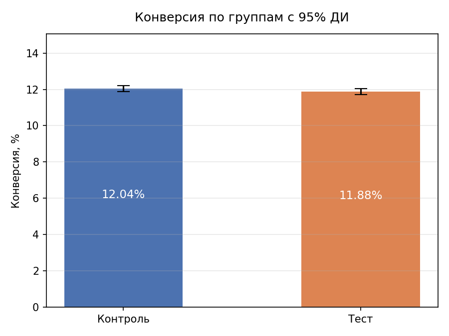
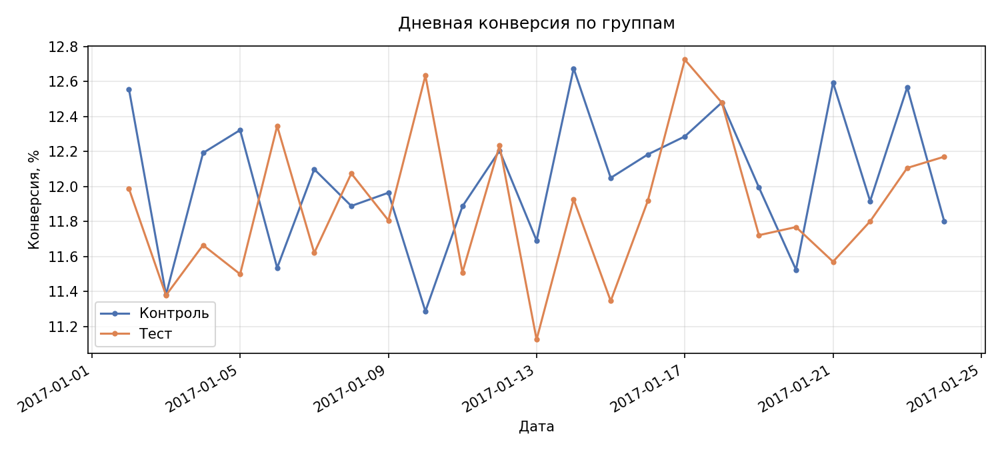
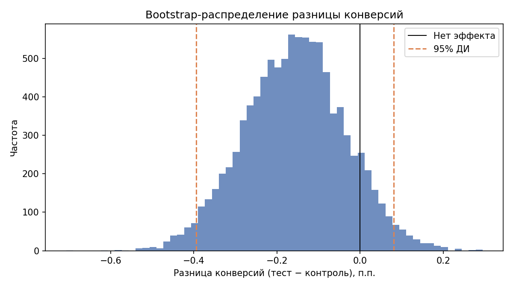

# A/B-тест новой посадочной страницы

Пет-проект: проверка, меняет ли новая посадочная страница конверсию.
Стек: DuckDB (SQL), Python (pandas, statsmodels, scipy, matplotlib), Jupyter.

## Итог
Новая страница не показала значимого изменения конверсии:
-0.16 п.п. (p = 0.19), 95% ДИ [-0.39; +0.08] п.п.
Рекомендация: не внедрять. Даже верхняя граница интервала намного ниже целевого MDE в 1 п.п.

## Данные
Датасет Udacity: `ab_data.csv` (294 478 строк, период 2-24 января 2017)
и `countries.csv` (страна пользователя).

## Валидация и очистка
| Причина исключения | Строк |
|---|---|
| группа не совпадает с показанной страницей | 3 893 |
| повторная строка пользователя | 1 |
| **Итого** | **3 894** |

- Осталось 290 584 пользователя, одна строка на пользователя.
- Несоответствия удалены до дедупликации: почти все дубли вызваны той же ошибкой,
  и при обратном порядке можно сохранить ошибочную строку вместо корректной.
- Исключённые строки сохранены в отдельную таблицу с причиной исключения.
- Пропусков нет, значения допустимые, все пользователи есть в `countries.csv`.
- Первые и последние сутки неполные из-за времени старта и остановки теста.
  Данные сохранены, результат проверен и без них.

## Дизайн
- H0: конверсия одинаковая, H1: различается (двусторонний тест), α = 0.05, мощность 80%.
- Для MDE 1 п.п. от базы 12% нужно 17 164 пользователя на группу, в данных 145 274.
- С этой выборкой обнаружим эффект от 0.34 п.п.

## Проверка Sample Ratio Mismatch
Хи-квадрат: p = 0.89 на сырых данных, p = 0.95 после очистки. Группы сбалансированы (50.01%).

## Результаты
| Группа | Пользователи | Конверсии | Конверсия |
|---|---|---|---|
| control | 145 274 | 17 489 | 12.04% |
| treatment | 145 310 | 17 264 | 11.88% |

| Проверка | Разница, п.п. | 95% ДИ, п.п. | p |
|---|---|---|---|
| z-тест, ДИ Ньюкомба | -0.16 | [-0.39; +0.08] | 0.19 |
| bootstrap, 10 000 итераций | -0.16 | [-0.39; +0.08] | - |
| без неполных дней | -0.16 | [-0.41; +0.08] | 0.18 |

## Ограничения
- Короткий период теста: эффект новизны мог не проявиться.
- Исключено 1.3% строк с ошибкой распределения.
- Базовая конверсия для расчёта мощности взята из этих же данных.
- Одна метрика, без guardrail-метрик.

## Дальнейшие шаги
- Разрез по странам с поправкой на множественные сравнения.
- Анализ подглядывания: динамика p-value по накопленным данным.
- Витрина данных для дашборда.

## Структура
- `sql/01_ingest.sql`: загрузка данных с явной схемой
- `sql/02_validation.sql`: проверки качества данных
- `sql/03_cleaning.sql`: очистка и реестр исключений
- `sql/04_metrics.sql`: метрики по группам, дням и странам
- `notebooks/analysis.ipynb`: статистический анализ и графики

## Как запустить
- `pip install -r requirements.txt`
- Открыть `notebooks/analysis.ipynb` и выполнить все ячейки. База `ab_test.duckdb` создаётся заново.
